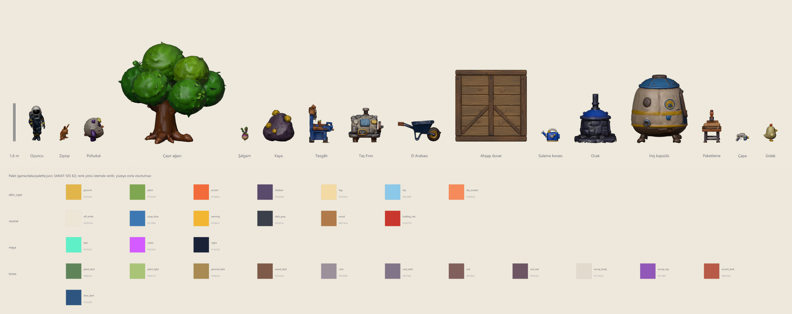
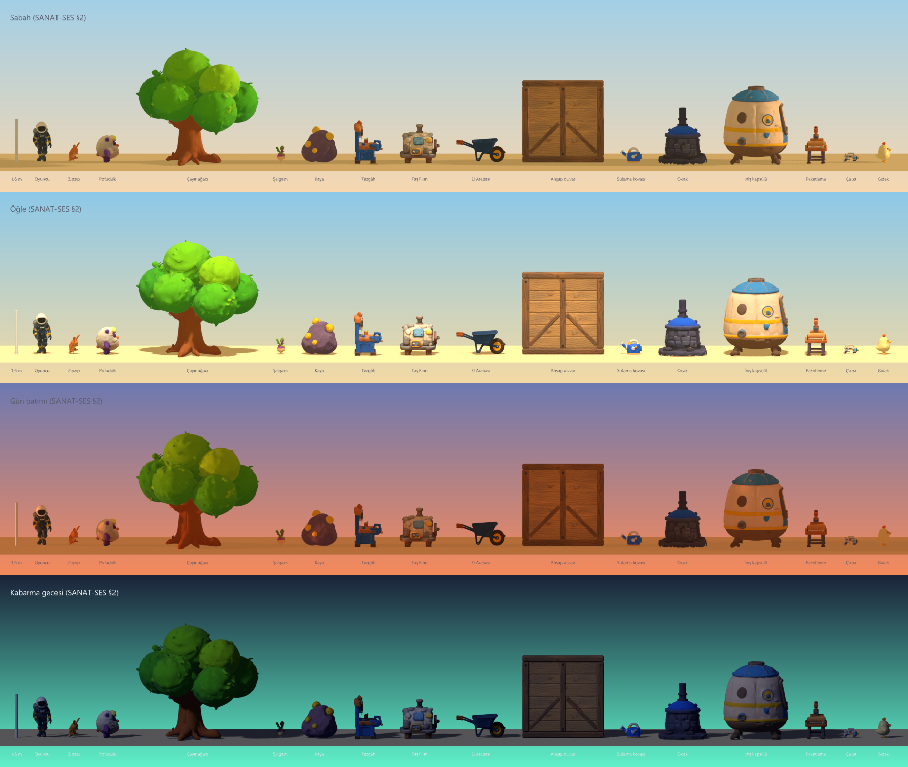
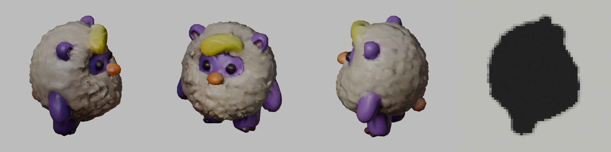
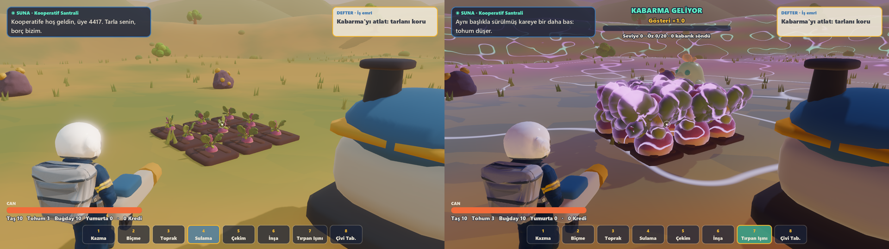
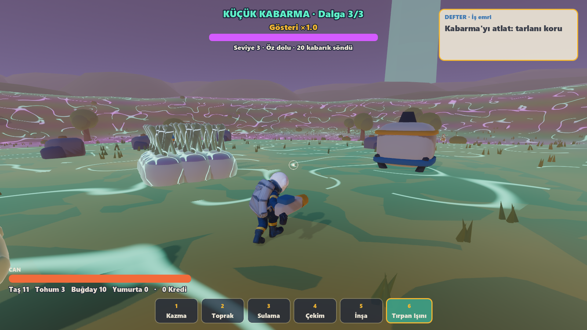

# Kabarma stil föyü

> URETIM.md §4: "M1'in ilk işi 12 altın varlık… Ondan sonra üretilen her varlık bu altın varlıklardan ikisini referans alır ve puanlamada onların yanında, aynı ışıkta görüntülenir."
> Sanat yönü, 17 Kasım 2026'da sahibinin kararıyla belirlendi: **dokulu, orta poligon, stilize el boyaması**. Flash oyunu ya da düz renkli çizgi film gibi durmaz ([SANAT-SES.md](../SANAT-SES.md) §1).

`pipeline/style_sheet.py` iki görüntüyü yeniden üretir (üstteki stüdyo + `game/data/palette.json` paleti, alttaki dört ışık: ölçüt 7'nin kanıtı). Yeni bir varlık eklenince `ITEMS` listesine konur ve görüntüler yeniden alınır.

## Altın varlıklar

Durum ve sekiz ölçüt tek kaynakta: [`game/data/assets.json`](../../game/data/assets.json) (`yer_tutucu` / `onay_bekliyor` / `altin`; `altin` yalnız sahip onaylayınca). Kartlar `progress/m1/varlik/kart/`, puan gerekçeleri `progress/m1/varlik/puanlar.md`.
Durum 18 Kasım 2026: **11 altın varlıktan 3'ü (Kaya, Şalgam, Taş Fırın) sekiz ölçütten geçti ve sahibin onayını bekliyor; 8'i yer tutucu.** Ölçüt 6–8 puanlarını varlık akışı verdi, hepsi sahibin onayını bekliyor.

| URETIM §4 sınıfı | Varlık | Kaynak | Üçgen (LOD0 / 1 / 2) | Doku | 3 kalınlık (çubuk alanı, izin %2) | 6 / 7 / 8 | Durum |
|---|---|---|---|---|---|---|---|
| Karakter | Oyuncu (tulumlu üye) | Genex karakter (Meshy), 6 klip | 10.348 | 2K | ölçülmedi (oyuncu akışı) | — | yer tutucu |
| Yaratık 1 | Zıpzıp | Tripo API H3.1 + iskelet + 4 klip | 5.764 (küçük sınıf 5.000: kalıyor) | 1K | ölçülmedi (yaratık akışı) | — | yer tutucu |
| Yaratık 2 | Pofuduk | Tripo API H3.1 + dört ayak iskeleti | 5.576 | 1K | ölçülmedi (yaratık akışı) | — | yer tutucu |
| Bitki 1 | Çayır ağacı | Tripo web "HD Model" | 6.790 / 3.292 / 1.316 | 1K | **%5,0 kaldı** | 9 / 8 / 9 | yer tutucu: yeniden üretim isteği |
| Bitki 2 | Şalgam (ekin ve kabarık ürün) | Tripo API H3.1 | 3.874 / 1.878 / 750 | 1K | %0,05 | 9 / 9 / 8 | sahibin onayını bekliyor |
| Kaya | Cevherli kaya | Tripo web "HD Model" | 3.858 / 1.870 / 746 | 1K | %0,08 | 8 / 8 / 8 | sahibin onayını bekliyor |
| Makine 1 | Tezgâh | Tripo API H3.1 | 7.424 / 3.600 / 1.438 | 1K | %1,4 | **7** / 8 / 8 | yer tutucu (siluet) |
| Makine 2 | Taş Fırın (düğümler `body, base, door, door_handle, chimney, panel`) | Tripo API H3.1 + parçalama | 4.870 / 2.360 / 944 | 1K | %1,2 | 8 / 8 / 8 | sahibin onayını bekliyor |
| Araç | El Arabası (düğümler `body, wheel_pivot/wheel, frame_l, frame_r, grip_l, grip_r, fork`; soketler `handle, handle_l, handle_r, load_slot`) | Tripo API H3.1 + parçalama | 5.998 / 2.908 / 1.162 | 1K | **%6,6 kaldı** | 9 / **6** / — | yer tutucu: yeniden üretim isteği; oyunda yok |
| Yapı köşesi | Ahşap yapı seti | Blender betiği (koddan) | 200–1.500/parça | 1K | ölçülmedi (sahibi yok) | — | yer tutucu |
| Eşya | Sulama kovası | Tripo web "HD Model" | 2.846 / 1.380 / 550 | 1K | %0,4 | **7** / 8 / 8 | yer tutucu (siluet) |
| Kabarık ürün | Kabarık şalgam | Şalgam modeli + `swell_tex` shader | aynı | aynı | aynı | aynı | Şalgam'la birlikte |
| Ek | Ocak | Tripo API H3.1 | 7.714 / 3.740 / 1.494 | 1K | %1,8 | 8 / **7** / **7** | yer tutucu (çok koyu) |
| Ek | İniş kapsülü / Kargo Rampası (düğümler `body, base, hatch`) | Tripo API H3.1 + parçalama | 9.546 / 4.628 / 1.850 | 1K | %1,2 | 8 / **7** / 8 | yer tutucu (pencere içi) |
| Ek | Paketleme Tezgâhı | Tripo API H3.1 | 7.432 / 3.606 / 1.444 | 1K | %1,2 | 8 / 8 / **7** | yer tutucu (okunaklılık) |
| Ek | Çapa | Tripo API H3.1 | 3.706 / 1.795 / 717 | 1K | **%2,1 kaldı** | **6** / 8 / **7** | yer tutucu: yeniden üretim isteği |
| Ek | Gıdak | Genex | — | — | ölçülmedi (yaratık akışı) | — | yer tutucu |

Ölçüt 1, 2, 4 ve 5 bütün altın varlıklarda geçiyor (betik). Yeniden üretim isteği (kredi harcanmadı): `progress/m1/varlik/uretim_istegi.md`.

## Kurallar

**İstem dili** (Tripo, `pipeline/gen_golden.sh`, `pipeline/gen_retry.py`):
- Nesneyi tarif et, sahneyi değil. Sonuna her zaman şu stil cümlesini ekle: *"Stylised hand-painted game asset, grounded believable materials with subtle wear, chunky readable silhouette, soft bevelled forms, no thin spikes, warm sunny sci-fi farm on a golden meadow moon."*
- **Kullanma:** "cartoon", "flat colours", "low-poly", "toy-like". Bunlar M0'da düz, plastik ve flash oyunu gibi bir sonuç verdi (aşağıda yanlış örnekler).
- Renk yönü istemde kelimeyle verilir (kooperatif mavisi, uyarı sarısı, kırık beyaz, Maya turkuazı); palet yüzeye zorla oturtulmaz.
- İnce parça isteme: boru çerçeve, çubuk, anten, sivri kök ölçüt 3'te kalıyor (El Arabası, Ağaç, Çapa). "thick, rounded, as thick as a wrist" yaz.
- Model: Tripo H3.1 (`tripo-v3.1`), doku `texture_version=v3.5`, `texture_quality=detailed` altın ve kahraman varlıklarda, `standard` dolgu varlıklarında.

**Hat** (`pipeline/run_golden.py` → `pipeline/clean_asset.py --keep_texture`, ayrıntı `pipeline/README.md`): kaynak kaynaşır, bütçeye sadeleşir, **onarım** (şerit yüzler, ikiden çok yüzlü kenar, delik kapama, sarım), havada kalan kırıntı atılır ya da yüzeye yaslanır, doku 1K'ya iner, boy ve taban oturur, açıyla sert kenar. Makinelerde `--parts`: Tripo'nun parçaları adlı düğüm olur (`door`, `chimney`, `wheel`, `hatch`…), pivot ve soket betikle konur, hareketleri kodla verilir. Her varlık için **iki LOD** (`_lod1.glb` yarı üçgen 512 px, `_lod2.glb` beşte bir 256 px), **çarpışma kabuğu** (`_hull.tres`, `ConvexPolygonShape3D`, ≤64 nokta), **ikon** (`_icon.png`, 256 px saydam) ve **varlık kartı** (`progress/m1/varlik/kart/`).

**Ölçüt 3 (kalınlık örneklemesi):** her yüzden içe ışınla yerel kalınlık; sınır en uzun kenarın %6'sı. Sınırın altındaki yüzün çevresi iki yönde de inceyse çubuk/diken (kırmızı), tek yönde inceyse levha (turuncu: yaprak, kapak, raf). Çubuk/diken alanı yüzeyin %2'sini geçmez. Eski ölçü (parçanın en dar kutu kenarı / en uzun kenar) raporda yan yana durur; eskisi Ağaç ve Çapa'yı geçiriyor, El Arabası'nı (0,045) kaldırıyordu.

**Bütçe** ([SANAT-SES.md](../SANAT-SES.md) §4, `assets.json` `budgets`): oyuncu 10–15 bin, küçük yaratık 5 bin, orta 8 bin, eşya ve kaya 2–6 bin, ağaç 5–8 bin, makine 8–15 bin, araç 12–20 bin üçgen; doku eşya 1K, yaratık ve makine 1–2K, oyuncu ve Ata 2K (araç ve ağaç için belge susuyor: 1K alındı). Üst sınırdır: altında kalan (El Arabası 6 bin) geçer.

**Ön yön:** Tripo modelleri +X'e bakar; kod bunu telafi ediyor (Kapsül −90°, Taş Fırın menteşesi). Yeni kod da +X varsaysın; `assets.json` her varlığın `forward` alanını yazar.

**Kabarma görünüşü:** bütün dokulu modeller `Swellable` ile `swell_tex.gdshader`'a geçer: kendi dokusu korunur, üstüne şişme, yay titremesi, Maya damarları, kenar ışıması ve isabet parlaması eklenir. Işıyan tek şey Maya'dır (SANAT-SES §1.5).

## Doğru ve yanlış

| Doğru | Yanlış |
|---|---|
|  Dokulu, okunaklı siluet |  Dokuyu palete zorla oturtmak: pişmiş gölge lekeleri, çamur gibi renk bölgeleri |
|  Aynı model gündüz ve Kabarma gecesinde |  MVP'deki koddan kurulmuş ilkel biçimler: işlevsel ama "programcı işi" |
