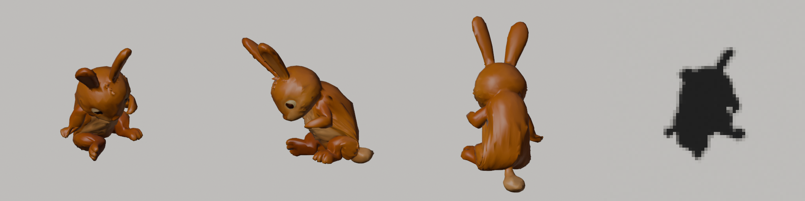

# Kabarma stil föyü

> URETIM.md §4: "M1'in ilk işi 12 altın varlık… Ondan sonra üretilen her varlık bu altın varlıklardan ikisini referans alır ve puanlamada onların yanında, aynı ışıkta görüntülenir."
> Sanat yönü, 17 Kasım 2026'da sahibinin kararıyla belirlendi: **dokulu, orta poligon, stilize el boyaması**. Flash oyunu ya da düz renkli çizgi film gibi durmaz ([SANAT-SES.md](../SANAT-SES.md) §1).

`pipeline/style_sheet.py` bu görüntüyü yeniden üretir; yeni bir varlık eklenince listeye konur ve görüntü yeniden alınır.

## Altın varlıklar

| URETIM §4 sınıfı | Varlık | Kaynak | Üçgen | Doku | Kredi |
|---|---|---|---|---|---|
| Karakter | Oyuncu (tulumlu üye) | Genex karakter (Meshy), 6 klip | 10.348 | 2K | 64 Genex |
| Yaratık 1 | Zıpzıp | Tripo API H3.1 + iki ayak iskeleti v3.0 + 4 klip (bekleme, koşu, zıplama, acı) | 5.764 (küçük sınıf: 5.000'e indirilecek, [SANAT-SES.md](../SANAT-SES.md) §4) | 1K | 95 Tripo |
| Yaratık 2 | Pofuduk | Tripo API H3.1 + dört ayak iskeleti v2.5 + yürüme | 5.576 (orta sınıf) | 1K | 55 Tripo |
| Bitki 1 | Çayır ağacı | Tripo web "HD Model" | 6.788 | 1K | 55 web |
| Bitki 2 | Şalgam (ekin ve kabarık ürün) | Tripo API H3.1, doku v3.5 ayrıntılı | 3.878 | 1K | 30 Tripo |
| Kaya | Cevherli kaya | Tripo web "HD Model" | 3.879 | 1K | 55 web |
| Makine 1 | Tezgâh | Tripo API H3.1, doku v3.5 ayrıntılı | 7.428 | 1K | 30 Tripo |
| Makine 2 | Taş Fırın (6 parça; düğümler `base, body, door, door_handle, part_4, part_5`, baca ve pano adı yok: `--rename` ile yeniden işlenecek) | Tripo API H3.1 + anlamsal parçalama | 4.773 | 1K | 60 Tripo |
| Araç | El Arabası (teker ayrı parça; henüz oyunda kullanılmıyor) | Tripo API H3.1 + parçalama | 5.779 | 1K | 70 Tripo |
| Yapı köşesi | Ahşap yapı seti | Blender betiği (koddan, milimetrik yuvalar) | 200–1.500/parça | 1K | 0 |
| Eşya | Sulama kovası | Tripo web "HD Model" | 2.908 | 1K | 55 web |
| Kabarık ürün | Kabarık şalgam | Şalgam modeli + `swell_tex` shader (şişme, Maya damarları) | aynı | aynı | 0 |

Ek altın varlıklar (M1 ihtiyacı): Ocak (30), İniş kapsülü / Kargo Rampası (kapak parçası, 70), Paketleme Tezgâhı (30), Çapa (30), Gıdak (Genex, 35).

## Kurallar

**İstem dili** (Tripo, `pipeline/gen_golden.sh`):
- Nesneyi tarif et, sahneyi değil. Sonuna her zaman şu stil cümlesini ekle: *"Stylised hand-painted game asset, grounded believable materials with subtle wear, chunky readable silhouette, soft bevelled forms, no thin spikes, warm sunny sci-fi farm on a golden meadow moon."*
- **Kullanma:** "cartoon", "flat colours", "low-poly", "toy-like". Bunlar M0'da düz, plastik ve flash oyunu gibi bir sonuç verdi (aşağıda yanlış örnekler).
- Renk yönü istemde kelimeyle verilir (kooperatif mavisi, uyarı sarısı, kırık beyaz, Maya turkuazı); palet yüzeye zorla oturtulmaz.
- Model: Tripo H3.1 (`tripo-v3.1`), doku `texture_version=v3.5`, `texture_quality=detailed` altın ve kahraman varlıklarda, `standard` dolgu varlıklarında.

**Hat** (`pipeline/clean_asset.py --keep_texture`): kaynak kaynaşır, bütçeye sadeleşir, delikler kapanır, doku 1K'ya iner, boy ve taban oturur, açıyla sert kenar. Makinelerde `--parts`: Tripo'nun parçaları adlı düğüm olur (`door`, `wheel`, `hatch`…), hareketleri kodla verilir.

**Bütçe** ([SANAT-SES.md](../SANAT-SES.md) §4): oyuncu 10–15 bin, küçük yaratık 5 bin, orta 8 bin, eşya ve kaya 2–6 bin, ağaç 5–8 bin, makine 8–15 bin üçgen; doku 1K (yaratık ve makine en fazla 2K).

**Kabarma görünüşü:** bütün dokulu modeller `Swellable` ile `swell_tex.gdshader`'a geçer: kendi dokusu korunur, üstüne şişme, yay titremesi, Maya damarları, kenar ışıması ve isabet parlaması eklenir. Işıyan tek şey Maya'dır (SANAT-SES §1.5).

## Doğru ve yanlış

| Doğru | Yanlış |
|---|---|
|  Dokulu, okunaklı siluet |  Dokuyu palete zorla oturtmak: pişmiş gölge lekeleri, çamur gibi renk bölgeleri |
|  Aynı model gündüz ve Kabarma gecesinde |  MVP'deki koddan kurulmuş ilkel biçimler: işlevsel ama "programcı işi" |
